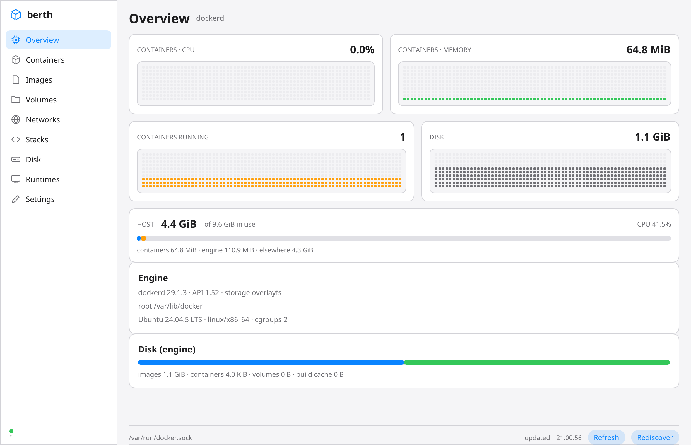

# berth

A native monitor for container runtimes — Docker, Podman, Colima and Lima — on
macOS and Linux. One binary, no webview, no daemon of its own.

Built in Zig 0.17 on [nanoui](https://github.com/justrach/nanoui).



## What works today

| | |
|---|---|
| **Engines** | Docker Desktop, dockerd, Colima, Lima, Podman machine, rootless and rootful Podman — discovered by probing, not by guessing |
| **Protocol** | HTTP/1.1 over a Unix socket, chunked bodies, API version negotiated from `/version` |
| **Views** | Overview, Containers, Images, Volumes, Networks, Stacks (Compose), Disk, Runtimes, Settings |
| **Live figures** | per-container CPU and memory (two-sample deltas, matching `docker stats`), container history graphs, host CPU and memory |
| **Memory split** | containers · engine · elsewhere — the engine's own RSS on Linux |
| **Actions** | start, stop, restart, delete — verified end to end against a live engine |
| **Detail** | container facts plus its last 200 log lines, with Docker's 8-byte stream framing demuxed |
| **Appearance** | follows the desktop, or System / Light / Dark, remembered between launches |

## What is not there yet

- **macOS host figures.** `src/host/macos.zig` is written against `sysctl` but
  has **never been compiled** — this was developed on Linux with no macOS SDK.
  Expect to fix a type or a sysctl name there first.
- **Search.** Filters exist (All / Running / Stopped); text search does not.
- **Events.** The `/events` stream is not read yet, so there is no Events view.
- **Compose actions.** Stacks are grouped and shown; `up`/`down` are not wired.
- **Packaging.** No `.app` bundle, no DMG, no notarization.
- **Accessibility** beyond what the framework gives on Apple platforms.

## Building

Needs **Zig 0.17.0** and nothing else. nanoui is fetched and pinned by `build.zig.zon`.

```sh
zig build                 # debug binary in zig-out/bin
zig build test            # protocol, JSON, formatting — no engine needed
zig build lines           # every file at most 600 lines
zig build dist            # ReleaseFast + a tarball in zig-out/dist
```

Measured on Linux x86_64 with Zig 0.17.0: **1.6 MB** stripped ReleaseFast
(9.3 MB unstripped), about **2 minutes** cold. The binary links nothing at
build time — GTK is `dlopen`'d at run time on Linux, and the Mac uses system
frameworks.

Linux needs **GTK 3 or 4 at run time** (dlopen'd, not linked) and a display.
macOS needs nothing beyond the system frameworks.

## Running

```sh
zig-out/bin/berth
```

It finds the engine itself. If none answers, the Runtimes view says what was
probed and the Settings view explains the appearance options.

### Headless, for review and CI

The app can drive itself, which is how every screenshot in `docs/ui/` was made:

```sh
# a view as a PNG, no window
BERTH_TAB=containers zig-out/bin/berth --nanoui-snapshot=/tmp/containers.png --nanoui-wait=6

# with one container's detail pane open
BERTH_TAB=containers BERTH_SELECT=my-container zig-out/bin/berth --nanoui-snapshot=/tmp/detail.png --nanoui-wait=10

# run an action through the same path the buttons use
BERTH_TAB=containers BERTH_ACT=stop:my-container zig-out/bin/berth --nanoui-snapshot=/tmp/stopped.png --nanoui-wait=9

# a filter
BERTH_FILTER=running ...
```

`--nanoui-wait` matters: it runs the event loop for that many seconds first, so
the snapshot has live data rather than a skeleton.

## How it is built

```
src/main.zig        app, window, the BERTH_* harness flags
src/app.zig         state, the refresh chain, actions, sampling
src/tabs.zig        views and filters
src/engine/         http_uds (the protocol), api (types), stats (cpu/mem/logs), discovery (sockets)
src/host/           linux (/proc), macos (sysctl, unbuilt), none
src/ui/shell.zig    rail, status bar, detail pane
src/ui/views/       lists (containers, images, volumes, networks), panels (overview, disk, runtimes, settings), stacks
src/ui/graph.zig    cell graphs, after nanomon's
src/ui/history.zig  the ring of samples behind the graphs
src/ui/format.zig   the only number and time formatter
```

Rules this codebase holds itself to: **600 lines per file**, **no C shims**,
**nothing polls** (a refresh chain of one-shot callbacks), **UI on the main
thread**, and **no phase names in code**.

## Testing notes

- `zig build test` covers the protocol (chunked decoding, short bodies, frame
  demux), the JSON shapes (`/system/df` in both of its forms), the `/proc`
  parsers, the formatters, and the history ring.
- Actions and rendering were verified by hand against a live Docker 29.1.3
  engine; `docs/ui/*.png` are the evidence.
- `docs/PHASES.md` records what broke and why, phase by phase — read it before
  changing the refresh chain or anything that closes a layout box.

## Licence

MIT, as the framework it is built on.
