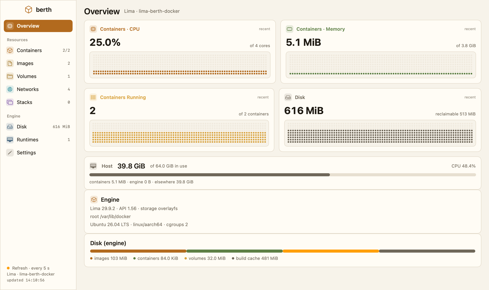

# berth

A native monitor for container runtimes — Docker, Podman, Colima and Lima — on
macOS and Linux. One binary, no webview, no daemon of its own, no telemetry.



Built in [Zig 0.17](https://ziglang.org) on [nanoui](https://github.com/justrach/nanoui).
The warm palette, live rail and cell graphs follow nanoui's sibling project,
[nanomon](https://github.com/justrach/nanomon).

## What it is

berth reads the engine's HTTP API over its Unix socket — the same API
`docker`, Podman and Colima expose — and turns it into a window that answers
three questions without a terminal:

- **What is running?** Containers with CPU, memory, ports, state and Compose
  project, plus the last 200 log lines for any one of them.
- **What does it cost?** Container CPU and memory over time, the host's memory
  split into containers, engine and everything else, and the engine's image,
  container, volume and build-cache stores.
- **What can I clean up?** Stopped containers, unused images and volumes,
  unused networks and build cache, with the reclaimable total shown before
  anything is removed.

## What works today

| | |
|---|---|
| **Engines** | Docker Desktop, OrbStack, Rancher Desktop, dockerd, Colima, Lima, Podman machine, rootless and rootful Podman — discovered by probing, grouped by kind, with a custom socket path |
| **Protocol** | HTTP/1.1 over a Unix socket, chunked bodies, API version negotiated from `/version` |
| **Views** | Overview, Containers, Images, Volumes, Networks, Stacks (Compose), Disk, Runtimes, Settings |
| **Tables** | sortable headers, search in every page header, clickable rows, and a column set that scales with the window |
| **Layout** | the rail folds to icons below 1120 points; the inspector is 430 or 360; tables choose one of five densities |
| **Live figures** | per-container CPU and memory (two-sample deltas, matching `docker stats`), network and disk I/O, PIDs, uptime and restarts, container history graphs, host CPU and memory |
| **Inspectors** | container facts and logs; image, volume and network details; the engine's raw JSON behind an Inspect tab |
| **Actions** | start, stop, pause, resume, restart, delete; open a published port in the browser; copy the `docker run` command; remove an image, volume or network |
| **Cleanup** | prune stopped containers, unused images/volumes/networks and build cache, with reclaimable sizes first |
| **Refresh** | a worker thread builds the next snapshot; the last complete one stays on screen, so tables never blink or stall |
| **Appearance** | follows the desktop, or System / Light / Dark, remembered between launches |

## What is not there yet

- **Events.** The `/events` stream is not read yet, so there is no Events view.
- **Compose actions.** Stacks are grouped and shown; `up`/`down` are not wired.
- **Run and pull.** berth watches and cleans engines; it does not pull images
  or create containers.
- **Packaging.** `macos/build.sh` makes an ad-hoc-signed `.app`; there is no DMG,
  Developer ID signature or notarization.
- **Accessibility** beyond what the framework gives on Apple platforms.

## Building

Needs **Zig 0.17.0** and nothing else. nanoui is fetched and pinned by `build.zig.zon`.

```sh
zig build                 # debug binary in zig-out/bin
zig build run             # build and open the window
zig build test            # protocol, JSON, formatting — no engine needed
zig build lines           # every file at most 600 lines
zig build dist            # ReleaseFast + a tarball in zig-out/dist
sh macos/build.sh         # ReleaseFast + zig-out/berth.app (macOS)
```

Measured on macOS arm64 with Zig 0.17.0: **1.3 MB** stripped ReleaseFast. The
binary links nothing at build time — GTK is `dlopen`'d at run time on Linux,
and the Mac uses system frameworks.

Linux needs **GTK 3 or 4 at run time** (dlopen'd, not linked) and a display.
macOS needs nothing beyond the system frameworks. `macos/build.sh` wraps the
binary, adds the icon and ad-hoc signs the bundle; run
`python3 macos/make-icon.py` only if you change the icon.

## Running

```sh
zig build run
# or the bundled app:
open zig-out/berth.app
```

It finds the engine itself. If none answers, the Runtimes view says what was
probed; Settings shows the active socket, the appearance choice and cleanup.

### Headless, for review and CI

The app can drive itself, which is how the screenshots in `docs/ui/` were made:

```sh
# a view as a PNG, no window
BERTH_TAB=containers zig-out/bin/berth --nanoui-snapshot=/tmp/containers.png --nanoui-wait=6

# with a container's detail pane open
BERTH_TAB=containers BERTH_SELECT=my-container zig-out/bin/berth --nanoui-snapshot=/tmp/detail.png --nanoui-wait=10

# an image, volume or network inspector
BERTH_TAB=images BERTH_SELECT=image:alpine:3.22 ...
BERTH_TAB=volumes BERTH_SELECT=volume:my-volume ...
BERTH_TAB=networks BERTH_SELECT=network:my-network ...

# run an action through the same path the buttons use
BERTH_TAB=containers BERTH_ACT=stop:my-container zig-out/bin/berth --nanoui-snapshot=/tmp/stopped.png --nanoui-wait=9

# a filter
BERTH_FILTER=running ...

# a particular window size and a search query
BERTH_SIZE=960x600 BERTH_TAB=containers BERTH_SEARCH=web ...
```

`--nanoui-wait` matters: it runs the event loop for that many seconds first, so
the snapshot has live data rather than a skeleton.

## How it is built

```
src/main.zig        app, window, the BERTH_* harness flags
src/app.zig         state, selection, actions, cleanup, host sampling
src/boot.zig        state construction and teardown
src/refresh.zig     the refresh worker and the single commit callback
src/snapshot.zig    one complete engine snapshot and its arena
src/stats_pool.zig  container stats, fetched together
src/tabs.zig        views and filters
src/engine/         http_uds (protocol), api (types), stats (cpu/mem/logs),
                    discovery (sockets), prune (cleanup endpoints)
src/host/           linux (/proc), macos (Mach host_statistics), none
src/ui/shell.zig    rail, inspector, confirmation and cleanup sheets
src/ui/theme.zig    the warm light/dark palette
src/ui/views/       lists, panels (overview, disk, runtimes, settings), stacks
src/ui/graph.zig    cell graphs, after nanomon's
src/ui/history.zig  the ring of samples behind the graphs
src/ui/format.zig   the only number and time formatter
src/ui/widgets.zig  shared rows, chips, pills and sortable headers
```

Rules this codebase holds itself to: **600 lines per file**, **no C shims**,
**no phase names in code**, **UI on the main thread**, and **one snapshot swap**
— the engine is read on a worker, never on the thread that paints.

The worker/snapshot model, ownership rules, test strategy and open risks are
written up in [docs/ARCHITECTURE.md](docs/ARCHITECTURE.md), and the ranked
feature roadmap drawn from Docker Desktop and Podman Desktop lives in
[docs/FEATURE-RESEARCH.md](docs/FEATURE-RESEARCH.md).

## Releases

Tagged builds are produced by GitHub Actions: a Linux x86_64 tarball, a macOS
arm64 `.app` zip, and `SHA256SUMS`. See the
[releases page](https://github.com/amscotti/berth/releases) for `v0.1.0`.

## Testing notes

- `zig build test` covers the protocol (chunked decoding, short bodies, frame
  demux), the JSON shapes (`/system/df` in both forms, prune replies), the
  `/proc` parsers, the formatters, and the history ring.
- Actions and rendering were verified against a live Docker 29.9.2 engine;
  `docs/ui/overview.png` is rendered from the current build. The rest of
  `docs/ui/` records the UI review and its before/after evidence.
- `docs/PHASES.md` records what broke and why, phase by phase — read it before
  changing the refresh worker or anything that closes a layout box.

## Licence

MIT — see [LICENSE](LICENSE) — as the framework it is built on.
